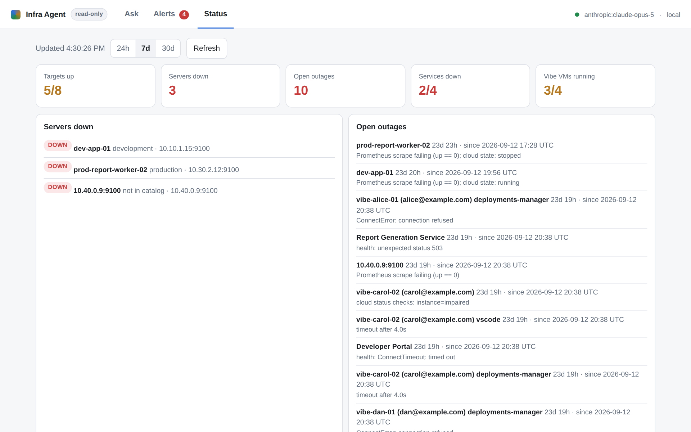
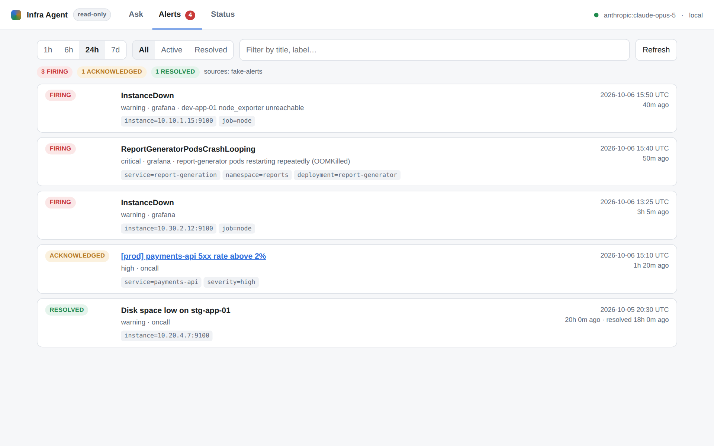

# Infra Agent

[](tests/)
[](pyproject.toml)
[](https://github.com/langchain-ai/langgraph)
[](LICENSE)

A read-only SRE assistant for a multi-cloud estate. Ask in plain English, in the web UI or in
Microsoft Teams:

- *Is the development server down?*
- *What was the API failure rate for the payments API in the past 24 hours?*
- *Are there any issues with the report generation service?*
- *What's our service uptime this month?* · *Is VS Code up on Alice's vibe VM?*

Answers come from Prometheus, Loki, Grafana alerting, Grafana OnCall and the AWS/Azure/GCP APIs,
grounded in a curated knowledge base. Every answer shows its evidence: the exact queries, time
ranges and Grafana links.

Built with LangGraph. Works with any hosted LLM that has a LangChain integration, and with any
metrics/logs/alerts stack via adapters.

## Why

On call, the same questions keep coming — in chat, from people who do not read
Grafana. Each one means opening three dashboards and a runbook. This agent
answers them from the telemetry already there, and shows the queries it ran so
the answer can be checked rather than trusted. It is deliberately read-only:
v1 has no tool that can change anything.

| Status tab (demo data) | Alerts tab (demo data) |
|---|---|
|  |  |

## Quick start (demo mode, no infrastructure needed)

```bash
python3 -m venv .venv && . .venv/bin/activate
pip install -e ".[anthropic,dev]"            # or [openai], [google], [bedrock]
export ANTHROPIC_API_KEY=...                  # or INFRA_AGENT_MODEL=openai:gpt-5 + OPENAI_API_KEY

infra-agent demo seed -c config/demo.yaml     # 14 days of synthetic downtime history
infra-agent serve -c config/demo.yaml         # http://localhost:8080
infra-agent ask -c config/demo.yaml "Is the development server down?"
```

Demo mode uses scenario-driven fake backends (`examples/demo/scenario.yaml`). The Alerts and
Status tabs and the Teams slash commands work without an API key. Only chat needs the model.

## Documentation

| Doc | For |
|---|---|
| [docs/design.md](docs/design.md) | Architecture, decisions, answer semantics, rollout plan |
| [docs/knowledge-base.md](docs/knowledge-base.md) | Building the catalog and runbooks for the real estate |
| [docs/deployment.md](docs/deployment.md) | Credentials, Teams bot setup, auth, running in production |
| [docs/extending.md](docs/extending.md) | Swapping models, writing backend adapters, adding tools |

## How it fits together

```
Web UI / Teams / CLI → LangGraph agent (ground → agent ⇄ tools → finalize)
                         ├─ Knowledge: catalog YAML · runbooks (BM25/hybrid) · downtime ledger
                         └─ Read-only tools → adapters: Prometheus · Loki · Grafana · OnCall · AWS/Azure/GCP · HTTP probes
Collector (every 60s) → ledger (outages beyond Prometheus' 7-day retention)
```

## Commands

```
infra-agent serve                       web UI + API + Teams endpoint + collector
infra-agent ask "question"              one-off question (--json for machine output)
infra-agent chat                        terminal conversation
infra-agent kb discover                 draft catalog from live Prometheus/Loki/cloud
infra-agent kb validate [--live]        schema, references, selectors actually match data
infra-agent kb search "text"            see how a question resolves to entities and docs
infra-agent collector run [--once]      standalone downtime collector
infra-agent ledger backfill --hours 168 import recent host outages from Prometheus
infra-agent eval run [--model X]        regression evals for the model, prompts and tools
```

Teams (instant, no LLM): `/alerts [6h]` · `/status` · `/downtime <host> [7d]` · `/health <service>` · `/uptime [30d]`

## Layout

```
src/infra_agent/
  agent/        LangGraph graph, tools, prompts, model factory, memory
  ops/          read-only investigations (shared by tools, UI, Teams)
  backends/     adapter interfaces + Prometheus, Loki, Grafana, OnCall, AWS/Azure/GCP, HTTP, fake
  knowledge/    catalog schema/resolution, docs index, discovery, live validation
  ledger/       downtime store + collector
  interfaces/   FastAPI app, web UI, Teams bot
config/         demo.yaml, agent.example.yaml
knowledge/      the real catalog and docs (to be built)
examples/demo/  sample catalog, runbooks, scenario
evals/          eval cases
tests/          pytest suite (runs offline)
```

## Development

```bash
pip install -e ".[all]"
pytest            # 87 tests, all offline: backends are faked or mocked with respx
```

v1 is strictly read-only: there are no tools that change infrastructure.

## Status

v1, built September 2026. Demo mode is complete; the adapters for Prometheus,
Loki, Grafana alerting/OnCall and the AWS/Azure/GCP inventories are written
against their public APIs and exercised by the offline tests. The real-estate
catalog under `knowledge/` is intentionally empty — `infra-agent kb discover`
drafts one from live Prometheus/Loki, and `docs/knowledge-base.md` explains
how to finish it.

---

Built by [Swaroop Rangle](https://github.com/swaroop002) — DevOps engineer,
Mumbai. [LinkedIn](https://www.linkedin.com/in/swaroop-rangle/) ·
[Portfolio](https://swaroop-portfolio-ten.vercel.app/)
